  

  
  

 

<h2 align="center">Sobre mim</h2>

  Sou estudante de Engenharia de Software e gosto mesmo é de backend e banco de dados: 
  montar APIs, modelar os dados direito e deixar o sistema organizado pra crescer sem virar bagunça. 
  Ultimamente ando estudando arquitetura de software, e padrões de projeto.

  🔧 APIs com Node/TypeScript e Python/Django &nbsp;&nbsp;·&nbsp;&nbsp;
  🗄️ PostgreSQL, MySQL e Prisma

 

<h2 align="center">Ferramentas que uso</h2>

BACKEND & DADOS

  

FRONTEND & MOBILE

  

DIA A DIA

  

 

<h2 align="center">Alguns projetos</h2>

<table align="center">
  <tr>
    <td width="50%" valign="top">
      <a href="https://github.com/Hafrannio-Menezes/coincap-open-api"><b>coincap-open-api</b></a> 
      API REST open source com dados de mercado de criptomoedas do CoinCap.  
      
      
    </td>
    <td width="50%" valign="top">
      <a href="https://github.com/Hafrannio-Menezes/api-consulta-dominio"><b>api-consulta-dominio</b></a> 
      API simples pra consultar RDAP/WHOIS de domínios.  
      
      
    </td>
  </tr>
  <tr>
    <td width="50%" valign="top">
      <a href="https://github.com/Hafrannio-Menezes/API-IF-BANK"><b>API-IF-BANK</b></a> 
      API bancária da faculdade, com documentação.  
      
    </td>
    <td width="50%" valign="top">
      <a href="https://github.com/Hafrannio-Menezes/padroes-projeto-java-hafrannio"><b>padroes-projeto-java</b></a> 
      12 refatorações aplicando padrões de projeto, com testes em JUnit.  
      
      
    </td>
  </tr>
  <tr>
    <td width="50%" valign="top">
      <a href="https://github.com/Hafrannio-Menezes/solid-java-hafrannio"><b>solid-java</b></a> 
      Os 5 princípios SOLID com exemplo errado, refatoração e testes.  
      
      
    </td>
    <td width="50%" valign="top">
      <a href="https://github.com/Hafrannio-Menezes/Desenvolvimento-Mobile"><b>Desenvolvimento-Mobile</b></a> 
      Exercícios de desenvolvimento mobile da faculdade.  
      
      
    </td>
  </tr>
</table>

 

<h2 align="center">Constância</h2>

  

 

  valeu pela visita! se quiser trocar uma ideia sobre algum projeto, abre uma issue ou me chama por aqui 👋

